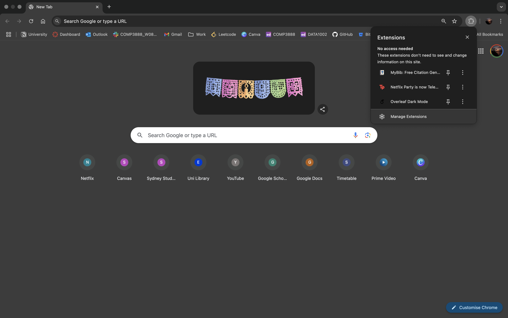
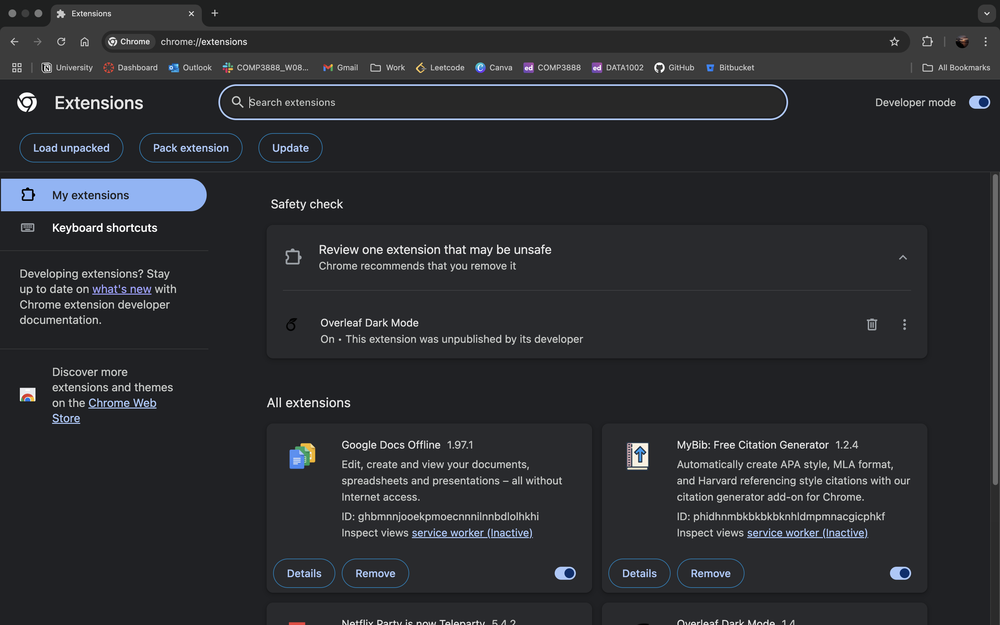
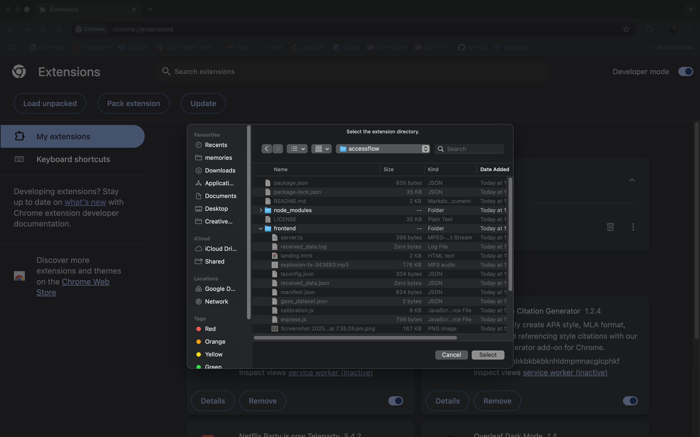
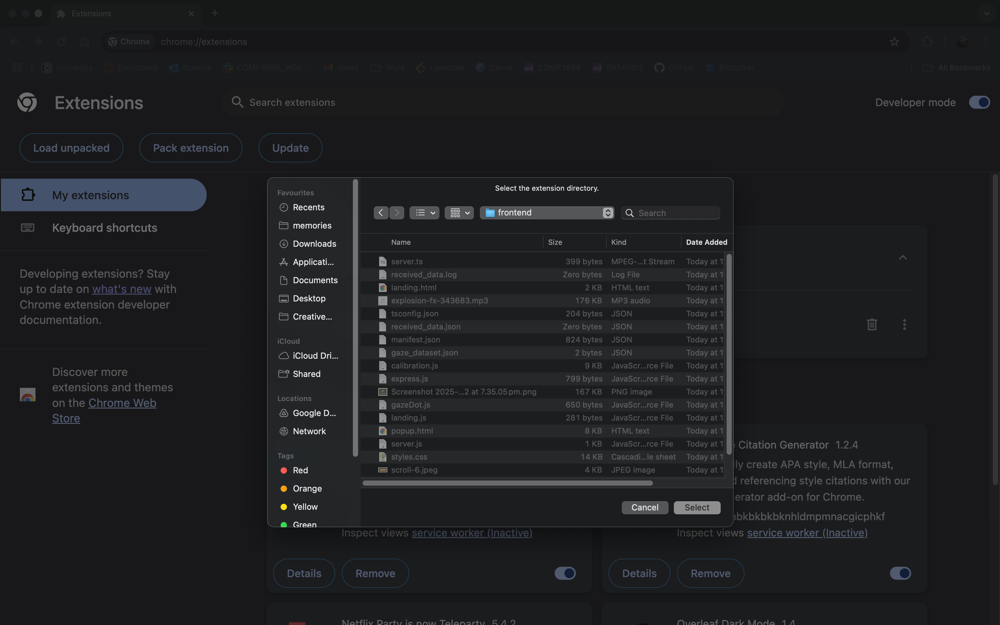
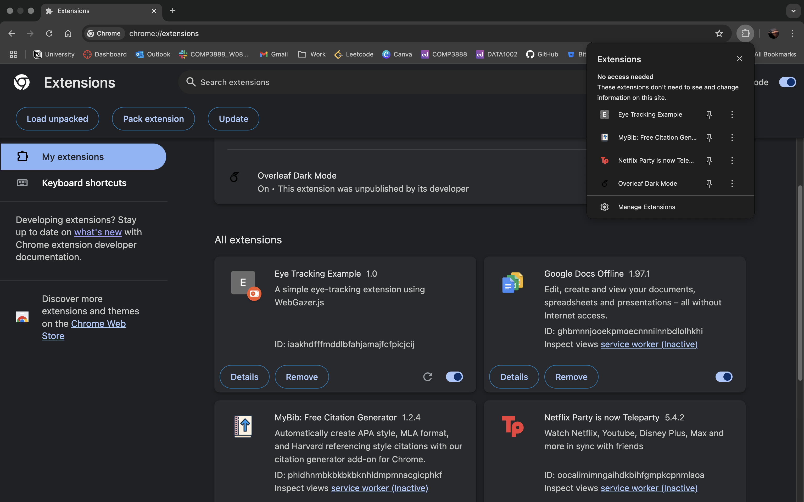

# AccessFlow: Eye-Tracking Browser Extension for Accessibility
AccessFlow is a low-cost, webcam-based eye-tracking system designed to enable hands-free navigation of web interfaces for users with mobility impairments. It provides accessible interaction through eye gestures, combining real-time gaze tracking, calibration, and smoothing techniques to enhance accuracy and usability.

# Features
- Real-time eye tracking using WebGazer.js.
- Interactive calibration with visual feedback.
- Smoothened gaze data for reliable pointing and navigation.
- Low-cost solution using standard webcams, no specialised hardware required.
- Designed for accessibility, especially for users with limited hand mobility.

# Demo
You can explore AccessFlow in two ways:  
- **Watch the Demo Video**  
See how AccessFlow works in action: [here](https://drive.google.com/file/d/1-4W6niUxVcLp4TOFMl7BBy_Zwuf3HhP0/view?usp=sharing).

- **Try It Yourself**  
Follow these steps to run AccessFlow locally:
    1. Open Chrome, click the Extensions icon in the toolbar, and select ‘Manage Extensions’

    

    2. Ensure Developer Mode is enabled (toggle in the top-right corner). Once it’s on, click on Load unpacked

    

    3. Navigate to and select the AccessFlow folder

    

    4. Open the frontend folder inside AccessFlow, then click Select

    

    5. Once loaded, the extension should appear in the Extensions popup in Chrome

    

# Acknowledgements

- [WebGazer.js](https://webgazer.cs.brown.edu/) for webcam-based eye tracking
- Inspiration from research in low-cost accessibility and gaze-based interaction

